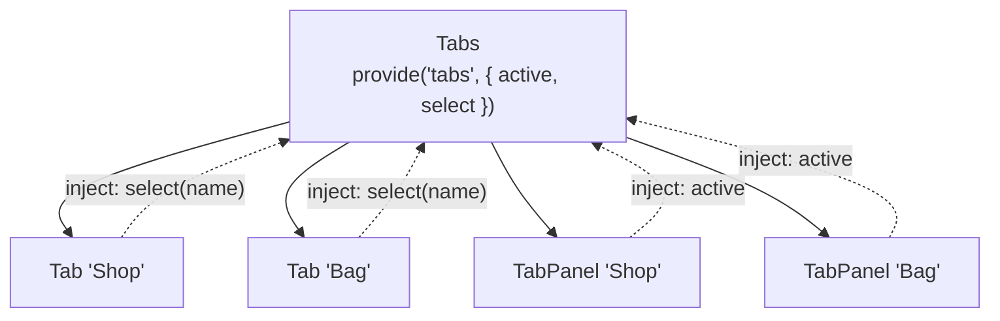

[Docs](../README.md) › [Guide](../GUIDE.md) › **13. Advanced component patterns**

# 13. Advanced component patterns

**You'll learn:** patterns for components that work together, components that share behaviour but
not looks, switching screens, and calling into a child.

## Compound components: Tabs that share state

Some components only make sense together: tabs and their panels, a menu and its items. The parent
**provides** shared state, and each piece **injects** it, so the parts can be arranged freely
without passing props between them.



```lua
local TABS = "tabs" -- the injection key, shared by the three components

local Tabs = Rivue.defineComponent({
	name = "Tabs",
	props = { initial = { type = "string", required = true } },
	setup = function(props)
		local active = Rivue.ref(props.initial)
		Rivue.provide(TABS, {
			active = active,
			select = function(name: string)
				active.value = name
			end,
		})
		return {}
	end,
	render = function(ctx)
		return h("Frame", { layout = { gap = 4 } }, ctx.renderSlot("default"))
	end,
})

local Tab = Rivue.defineComponent({
	name = "Tab",
	props = { name = { type = "string", required = true } },
	setup = function(props)
		local tabs = Rivue.inject(TABS)
		return {
			tabs = tabs,
			select = function()
				tabs.select(props.name)
			end,
		}
	end,
	render = function(ctx)
		local selected = ctx.tabs.active.value == ctx.name
		return h("TextButton", { class = { "tab", selected and "tab-selected" }, Text = ctx.name, onClick = ctx.select })
	end,
})

local TabPanel = Rivue.defineComponent({
	name = "TabPanel",
	props = { name = { type = "string", required = true } },
	setup = function()
		return { tabs = Rivue.inject(TABS) }
	end,
	render = function(ctx)
		if ctx.tabs.active.value ~= ctx.name then
			return nil
		end
		return h("Frame", { Size = UDim2.fromScale(1, 1) }, ctx.renderSlot("default"))
	end,
})
```

Using them reads like markup:

```lua
h(Tabs, { initial = "Shop" }, {
	h("Frame", { layout = "horizontal" }, { h(Tab, { name = "Shop" }), h(Tab, { name = "Bag" }) }),
	h(TabPanel, { name = "Shop" }, { h(ShopList) }),
	h(TabPanel, { name = "Bag" }, { h(Inventory) }),
})
```

Note that `ctx.tabs.active.value` keeps its `.value`: only refs that `setup` returns directly are
unwrapped, not refs inside tables.

## Render-less components: behaviour without looks

When several components need the same behaviour but look different, put the behaviour in a
component that renders nothing of its own and passes its state to a **scoped slot**. The caller
decides what it looks like.

```lua
local Hoverable = Rivue.defineComponent({
	name = "Hoverable",
	setup = function()
		local hovered = Rivue.ref(false)
		return {
			hovered = hovered,
			enter = function()
				hovered.value = true
			end,
			leave = function()
				hovered.value = false
			end,
		}
	end,
	render = function(ctx)
		return h("Frame", {
			BackgroundTransparency = 1,
			Size = UDim2.fromScale(1, 1),
			onMouseEnter = ctx.enter,
			onMouseLeave = ctx.leave,
		}, ctx.renderSlot("default", { hovered = ctx.hovered }))
	end,
})

-- One caller shows a tooltip, another scales a card
h(Hoverable, nil, {
	default = function(scope)
		return h("TextLabel", { Text = if scope.hovered then "Sell for 40 coins" else "Iron Sword" })
	end,
})
```

Often a [composable](12-writing-composables.md) is the simpler choice. Use a render-less
component when the behaviour needs an Instance of its own, like this hover area.

## Switching screens: dynamic components

`h()` takes a component as a value, so switching screens is choosing which one to pass:

```lua
local screens = { lobby = Lobby, shop = Shop, settings = Settings }

local App = Rivue.defineComponent({
	name = "App",
	setup = function()
		return { screen = Rivue.ref("lobby") }
	end,
	render = function(ctx)
		return h(Rivue.KeepAlive, { include = { "Shop" } }, { -- keep the shop's scroll position
			h(screens[ctx.screen], {
				onNavigate = function(name)
					ctx.screen = name
				end,
			}),
		})
	end,
})
```

## Modals: Teleport, Transition and click-outside together

A modal opened from deep inside the UI must draw above everything, animate, and close when the
player clicks outside it:

```lua
local Modal = Rivue.defineComponent({
	name = "Modal",
	props = { open = { type = "boolean", required = true }, layer = { type = "Instance" } },
	emits = { "close" },
	render = function(ctx)
		return h(Rivue.Teleport, { to = ctx.layer, disabled = ctx.layer == nil }, {
			h(Rivue.Transition, { tweenInfo = TweenInfo.new(0.15), from = { BackgroundTransparency = 1 } }, {
				Rivue.hIf(
					ctx.open,
					h("Frame", {
						class = "modal",
						vClickOutside = function()
							ctx.emit("close")
						end,
					}, ctx.renderSlot("default"))
				),
			}),
		})
	end,
})
```

See the complete version in [examples/components/Modal.luau](../../examples/components/Modal.luau).

## Calling into a child: expose and template refs

Prefer props and events. When a parent really needs to tell a child to *do* something (reset a
form, scroll to the top, close), the child exposes a small API and the parent holds a template
ref to it:

```lua
local Form = Rivue.defineComponent({
	name = "Form",
	setup = function(_props, ctx)
		local name = Rivue.ref("")
		ctx.expose({
			reset = function()
				name.value = ""
			end,
		})
		return { name = name }
	end,
	render = function()
		return h("TextBox", { model = "name" })
	end,
})

local Page = Rivue.defineComponent({
	name = "Page",
	setup = function()
		local form = Rivue.useTemplateRef("form")
		return {
			clear = function()
				(form.value :: any).reset()
			end,
		}
	end,
	render = function(ctx)
		return h("Frame", { layout = { gap = 8 } }, {
			h(Form, { ref = "form" }),
			h("TextButton", { Text = "Clear", onClick = ctx.clear }),
		})
	end,
})
```

---

**Try it:** [Tabs example](../../examples/components/Tabs.luau) · [Modal example](../../examples/components/Modal.luau)
**Reference:** [provide()](../api/component.md#provide) · [Slots](../api/component.md#slots) ·
[KeepAlive](../api/builtins.md#keepalive) · [Teleport](../api/builtins.md#teleport) ·
[useTemplateRef()](../api/component.md#usetemplateref)

[← 12. Writing composables](12-writing-composables.md) · [Guide contents](../GUIDE.md) · [14. State architecture →](14-state-architecture.md)
