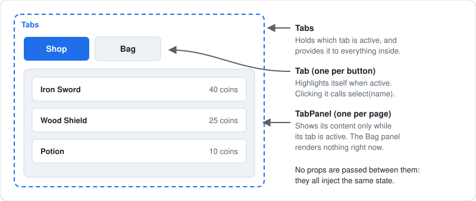
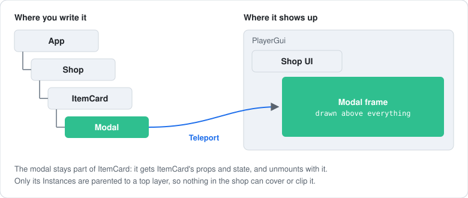

[Docs](../README.md) › [Guide](../GUIDE.md) › **13. Component patterns**

# 13. Component patterns

A grab bag of patterns that come up once a UI gets bigger: components that work as a set, a
component with no visuals of its own, switching screens, modals, and calling into a child.

## Components that share state: Tabs

One `Tabs` component that owns the whole layout gets rigid fast. Three small ones that cooperate
are easier to arrange:



`Tabs` provides the active tab once, and every `Tab` and `TabPanel` below it injects it, at any
depth ([chapter 8](08-state-and-server.md)):

```lua
local TABS = "tabs" -- the key all three components use to find the shared state

local Tabs = Rivue.defineComponent({
	name = "Tabs",
	props = { initial = { type = "string", required = true } },
	setup = function(props)
		local active = Rivue.ref(props.initial)
		Rivue.provide(TABS, {
			active = active,
			select = function(name: string)
				active.value = name
			end,
		})
		return {}
	end,
	render = function(ctx)
		return h("Frame", { layout = { gap = 4 } }, ctx.renderSlot("default"))
	end,
})
```

A `Tab` reads that state and calls `select`:

```lua
local Tab = Rivue.defineComponent({
	name = "Tab",
	props = { name = { type = "string", required = true } },
	setup = function(props)
		local tabs = Rivue.inject(TABS)
		return {
			tabs = tabs,
			select = function()
				tabs.select(props.name)
			end,
		}
	end,
	render = function(ctx)
		local selected = ctx.tabs.active.value == ctx.name
		return h("TextButton", {
			class = { "tab", selected and "tab-selected" },
			Text = ctx.name,
			onClick = ctx.select,
		})
	end,
})
```

> `ctx` only unwraps refs that `setup` returns directly. `active` is nested in a table, so it
> keeps its `.value`.

`TabPanel` only renders while its tab is active:

```lua
local TabPanel = Rivue.defineComponent({
	name = "TabPanel",
	props = { name = { type = "string", required = true } },
	setup = function()
		return { tabs = Rivue.inject(TABS) }
	end,
	render = function(ctx)
		if ctx.tabs.active.value ~= ctx.name then
			return nil
		end
		return h("Frame", { Size = UDim2.fromScale(1, 1) }, ctx.renderSlot("default"))
	end,
})
```

And the screen decides where everything goes:

```lua
h(Tabs, { initial = "Shop" }, {
	h("Frame", { layout = "horizontal" }, {
		h(Tab, { name = "Shop" }),
		h(Tab, { name = "Bag" }),
	}),
	h(TabPanel, { name = "Shop" }, { h(ShopList) }),
	h(TabPanel, { name = "Bag" }, { h(Inventory) }),
})
```

## Render-less components

Sometimes a component owns the behaviour and the caller decides how it looks, through a scoped
slot. `Hoverable` tracks the mouse and passes `hovered` down to its slot:

```lua
local Hoverable = Rivue.defineComponent({
	name = "Hoverable",
	setup = function()
		local hovered = Rivue.ref(false)
		return {
			hovered = hovered,
			enter = function()
				hovered.value = true
			end,
			leave = function()
				hovered.value = false
			end,
		}
	end,
	render = function(ctx)
		-- An invisible frame to catch the mouse, with the slot inside it
		return h("Frame", {
			BackgroundTransparency = 1,
			Size = UDim2.fromScale(1, 1),
			onMouseEnter = ctx.enter,
			onMouseLeave = ctx.leave,
		}, ctx.renderSlot("default", { hovered = ctx.hovered }))
	end,
})
```

Whatever you pass as the second argument to `renderSlot` is what the slot function receives:

```lua
h(Hoverable, nil, {
	default = function(slot)
		return h("TextLabel", {
			Text = if slot.hovered then "Sell for 40 coins" else "Iron Sword",
		})
	end,
})
```

Only reach for this when the behaviour needs an Instance of its own, as mouse events do here.
Otherwise a [composable](12-writing-composables.md) is simpler.

## Switching screens

Since `h()` takes a component value, switching screens is just a table lookup:

```lua
local screens = { lobby = Lobby, shop = Shop, settings = Settings }

local App = Rivue.defineComponent({
	name = "App",
	setup = function()
		return { screen = Rivue.ref("lobby") }
	end,
	render = function(ctx)
		return h(Rivue.KeepAlive, { include = { "Shop" } }, {
			h(screens[ctx.screen], {
				onNavigate = function(name)
					ctx.screen = name
				end,
			}),
		})
	end,
})
```

Normally, switching away unmounts a screen. `KeepAlive` keeps the ones in `include` alive instead,
so the shop is still scrolled where the player left it.

## Modals

A modal opened from deep inside the tree needs three built-ins working together:

| Piece | What it does |
|---|---|
| `Teleport` | moves the popup's Instances to a top layer, so nothing covers or clips it |
| `Transition` | fades it in when it appears and out when it goes |
| `vClickOutside` | calls a function when the player clicks anywhere outside it |



```lua
local Modal = Rivue.defineComponent({
	name = "Modal",
	props = {
		open = { type = "boolean", required = true },
		layer = { type = "Instance" }, -- a ScreenGui on top of the others
	},
	emits = { "close" },
	render = function(ctx)
		return h(Rivue.Teleport, { to = ctx.layer, disabled = ctx.layer == nil }, {
			h(Rivue.Transition, { tweenInfo = TweenInfo.new(0.15), from = { BackgroundTransparency = 1 } }, {
				Rivue.hIf(
					ctx.open,
					h("Frame", {
						class = "modal",
						vClickOutside = function()
							ctx.emit("close")
						end,
					}, ctx.renderSlot("default"))
				),
			}),
		})
	end,
})
```

The full version, with a backdrop and buttons, is in
[examples/components/Modal.luau](../../examples/components/Modal.luau).

## Calling a child with expose

Props and events cover most things. For one-off actions like "reset" or "scroll to top", the
child can expose functions instead, and the parent calls them through a template ref:

```lua
local Form = Rivue.defineComponent({
	name = "Form",
	setup = function(_props, ctx)
		local name = Rivue.ref("")
		-- What a parent holding a ref to this Form can call
		ctx.expose({
			reset = function()
				name.value = ""
			end,
		})
		return { name = name }
	end,
	render = function()
		return h("TextBox", { model = "name" })
	end,
})

local Page = Rivue.defineComponent({
	name = "Page",
	setup = function()
		local form = Rivue.useTemplateRef("form") -- filled in once the Form with ref = "form" mounts
		return {
			clear = function()
				(form.value :: any).reset()
			end,
		}
	end,
	render = function(ctx)
		return h("Frame", { layout = { gap = 8 } }, {
			h(Form, { ref = "form" }),
			h("TextButton", { Text = "Clear", onClick = ctx.clear }),
		})
	end,
})
```

---

**Try it:** [Tabs example](../../examples/components/Tabs.luau) · [Modal example](../../examples/components/Modal.luau)
**Reference:** [provide()](../api/component.md#provide) · [Slots](../api/component.md#slots) ·
[KeepAlive](../api/builtins.md#keepalive) · [Teleport](../api/builtins.md#teleport) ·
[useTemplateRef()](../api/component.md#usetemplateref)

[← 12. Writing composables](12-writing-composables.md) · [Guide contents](../GUIDE.md) · [14. Organising state →](14-state-architecture.md)
