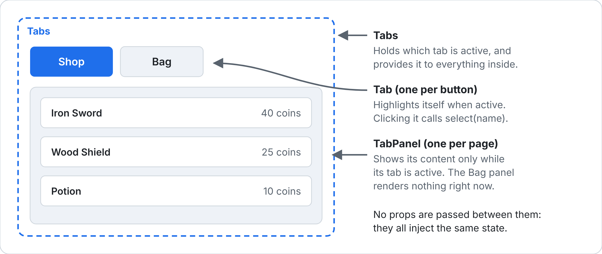
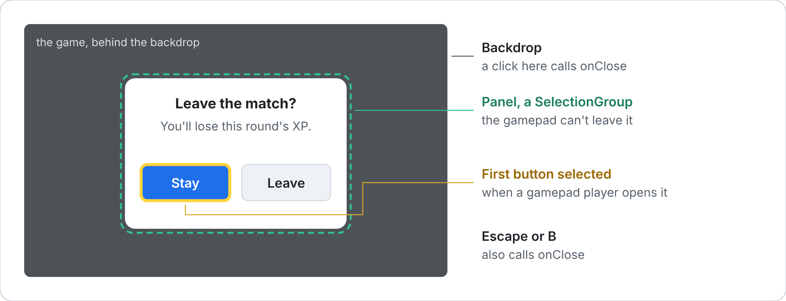
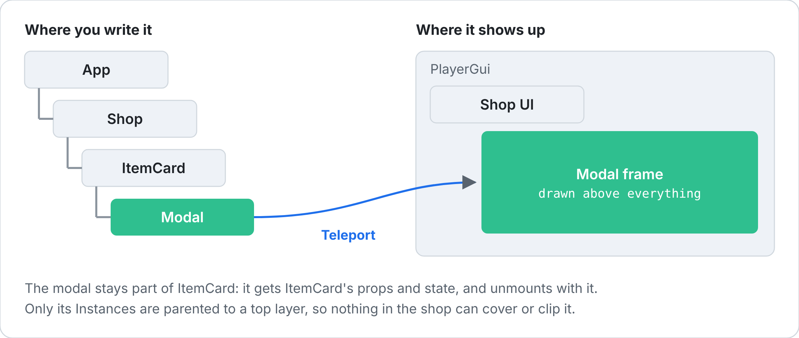

[Docs](../README.md) › [Guide](../GUIDE.md) › **13. Component patterns**

# 13. Component patterns

Patterns that come up once a UI gets bigger: components that work as a set, a component with no
visuals of its own, switching and lazy-loading screens, 3D previews, modals, error boundaries, and
calling into a child.

## Components that share state: Tabs

A single `Tabs` component that owns the whole layout gets rigid fast. Three small ones that work
together are easier to arrange:



`Tabs` provides the active tab once, and every `Tab` and `TabPanel` below it injects it, at any
depth ([chapter 8](08-state-and-server.md)):

```lua
local TABS = "tabs" -- the key all three components use to find the shared state

local Tabs = Rivue.defineComponent({
	name = "Tabs",
	props = { initial = { type = "string", required = true } },
	setup = function(props)
		local active = Rivue.ref(props.initial)
		Rivue.provide(TABS, {
			active = active,
			select = function(name: string)
				active.value = name
			end,
		})
		return {}
	end,
	render = function(ctx)
		return h("Frame", { layout = { gap = 4 } }, ctx.renderSlot("default"))
	end,
})
```

A `Tab` reads that state and calls `select`:

```lua
local Tab = Rivue.defineComponent({
	name = "Tab",
	props = { name = { type = "string", required = true } },
	setup = function(props)
		local tabs = Rivue.inject(TABS)
		return {
			tabs = tabs,
			select = function()
				tabs.select(props.name)
			end,
		}
	end,
	render = function(ctx)
		local selected = ctx.tabs.active.value == ctx.name
		return h("TextButton", {
			class = { "tab", selected and "tab-selected" },
			Text = ctx.name,
			onClick = ctx.select,
		})
	end,
})
```

> [!NOTE]
> `ctx` only unwraps refs that `setup` returns directly. `active` is nested in a table, so it
> keeps its `.value`.

`TabPanel` only renders while its tab is active:

```lua
local TabPanel = Rivue.defineComponent({
	name = "TabPanel",
	props = { name = { type = "string", required = true } },
	setup = function()
		return { tabs = Rivue.inject(TABS) }
	end,
	render = function(ctx)
		if ctx.tabs.active.value ~= ctx.name then
			return nil
		end
		return h("Frame", { Size = UDim2.fromScale(1, 1) }, ctx.renderSlot("default"))
	end,
})
```

The screen decides where everything goes:

```lua
h(Tabs, { initial = "Shop" }, {
	h("Frame", { layout = "horizontal" }, {
		h(Tab, { name = "Shop" }),
		h(Tab, { name = "Bag" }),
	}),
	h(TabPanel, { name = "Shop" }, { h(ShopList) }),
	h(TabPanel, { name = "Bag" }, { h(Inventory) }),
})
```

## Render-less components

A component can own a behaviour and let the caller decide how it looks, through a scoped slot.
`Hoverable` tracks the mouse and passes `hovered` to its slot:

```lua
local Hoverable = Rivue.defineComponent({
	name = "Hoverable",
	setup = function()
		local hovered = Rivue.ref(false)
		return {
			hovered = hovered,
			enter = function()
				hovered.value = true
			end,
			leave = function()
				hovered.value = false
			end,
		}
	end,
	render = function(ctx)
		-- An invisible frame to catch the mouse, with the slot inside it
		return h("Frame", {
			BackgroundTransparency = 1,
			Size = UDim2.fromScale(1, 1),
			onMouseEnter = ctx.enter,
			onMouseLeave = ctx.leave,
		}, ctx.renderSlot("default", { hovered = ctx.hovered }))
	end,
})
```

Whatever you pass as the second argument to `renderSlot` is what the slot function receives:

```lua
h(Hoverable, nil, {
	default = function(slot)
		return h("TextLabel", {
			Text = if slot.hovered then "Sell for 40 coins" else "Iron Sword",
		})
	end,
})
```

Use this only when the behaviour needs an Instance of its own, as mouse events do here. Otherwise a
[composable](12-writing-composables.md) is simpler.

## Switching screens

`h()` takes a component value, so switching screens can be a table lookup:

```lua
local screens = { lobby = Lobby, shop = Shop, settings = Settings }

local App = Rivue.defineComponent({
	name = "App",
	setup = function()
		return { screen = Rivue.ref("lobby") }
	end,
	render = function(ctx)
		return h(Rivue.KeepAlive, { include = { "Shop" } }, {
			h(screens[ctx.screen], {
				onNavigate = function(name)
					ctx.screen = name
				end,
			}),
		})
	end,
})
```

Switching away normally unmounts a screen. `KeepAlive` keeps the ones in `include` alive, so the
shop is still scrolled where the player left it.

Once screens need a back button or pass each other data, use
[RivueRouter](17-screens-and-navigation.md) instead. It keeps the history, passes params to the
screen as props, and can keep screens alive the same way.

## Loading a screen when it's first opened

A big screen the player may never open doesn't need to be required at startup.
`Rivue.defineAsyncComponent` takes a loader and shows a placeholder until it returns:

```lua
local Settings = Rivue.defineAsyncComponent(function()
	return require(game.ReplicatedStorage:WaitForChild("Settings")) :: any
end, {
	loadingComponent = h("TextLabel", { Text = "Loading..." }),
	errorComponent = h("TextLabel", { Text = "Couldn't load settings" }),
})
```

It can also time out and retry; see [defineAsyncComponent()](../api/component.md#defineasynccomponent).

## Showing a 3D item

`Rivue.ViewportModel` puts a model in the UI with a camera that fits it, for shop and inventory
previews:

```lua
h(Rivue.ViewportModel, {
	model = game.ReplicatedStorage.Items.Sword, -- must be Archivable; Rivue clones it
	Size = UDim2.fromOffset(120, 120),
	angle = 45,
})
```

## Modals

`Rivue.Dialog` covers the usual modal: a backdrop, closing on a backdrop click, Escape or the
gamepad's B button, and gamepad focus that starts on the first button and stays inside the panel.



```lua
h(Rivue.Dialog, { open = ctx.confirming, onClose = ctx.cancel, transition = Rivue.transitions.pop() }, {
	h(Rivue.Column, { gap = 12 }, {
		h("TextLabel", { Text = "Leave the match?" }),
		h(Rivue.Row, { gap = 8 }, {
			h("TextButton", { Text = "Stay", onActivated = ctx.cancel }),
			h("TextButton", { Text = "Leave", onActivated = ctx.leave }),
		}),
	}),
})
```

The dialog doesn't close itself. `onClose` says the player wants out, and you set `open` to false.
It covers its parent, so put it under a full-screen ScreenGui, or Teleport it to one.

For a popup that doesn't fit Dialog, the same parts are available on their own:

| Piece | What it does |
|---|---|
| `Teleport` | moves the popup's Instances to a top layer, so nothing covers or clips it |
| `Transition` | tweens it in when it appears and out when it goes |
| `vClickOutside` | calls a function when the player clicks anywhere outside it |



[examples/components/Modal.luau](../../examples/components/Modal.luau) puts them together, with
named slots for the title and the content.

## Error boundaries

Wrap a risky part, like a panel that shows server data, in `Rivue.ErrorBoundary` so an error inside
it shows a fallback instead of breaking the whole screen:

```lua
h(Rivue.ErrorBoundary, {
	fallback = function(_message, reset)
		return h("TextButton", { Text = "The shop didn't load. Tap to try again", onActivated = reset })
	end,
}, {
	h(ShopItems),
})
```

`reset` mounts the children again. The error stops at the boundary, so it doesn't reach
`app.config.errorHandler`. Pass `onError` if you still want to log it. To build your own boundary,
use the `onErrorCaptured` hook it's made from.

## Calling a child with expose

Props and events cover most things. For one-off actions like "reset" or "scroll to top", the
child can expose functions, and the parent calls them through a template ref:

```lua
local Form = Rivue.defineComponent({
	name = "Form",
	setup = function(_props, ctx)
		local name = Rivue.ref("")
		-- What a parent holding a ref to this Form can call
		ctx.expose({
			reset = function()
				name.value = ""
			end,
		})
		return { name = name }
	end,
	render = function()
		return h("TextBox", { model = "name" })
	end,
})

local Page = Rivue.defineComponent({
	name = "Page",
	setup = function()
		local form = Rivue.useTemplateRef("form") -- filled in once the Form with ref = "form" mounts
		return {
			clear = function()
				(form.value :: any).reset()
			end,
		}
	end,
	render = function(ctx)
		return h("Frame", { layout = { gap = 8 } }, {
			h(Form, { ref = "form" }),
			h("TextButton", { Text = "Clear", onClick = ctx.clear }),
		})
	end,
})
```

---

**Try it:** [Tabs example](../../examples/components/Tabs.luau) · [Modal example](../../examples/components/Modal.luau)\
**Reference:** [provide()](../api/component.md#provide) · [Slots](../api/component.md#slots) ·
[KeepAlive](../api/builtins.md#keepalive) · [defineAsyncComponent()](../api/component.md#defineasynccomponent) ·
[ViewportModel](../api/builtins.md#viewportmodel) · [Dialog](../api/builtins.md#dialog) ·
[ErrorBoundary](../api/builtins.md#errorboundary) · [Teleport](../api/builtins.md#teleport) ·
[useTemplateRef()](../api/component.md#usetemplateref)

[← 12. Writing composables](12-writing-composables.md) · [Guide contents](../GUIDE.md) · [14. Organising state →](14-state-architecture.md)
