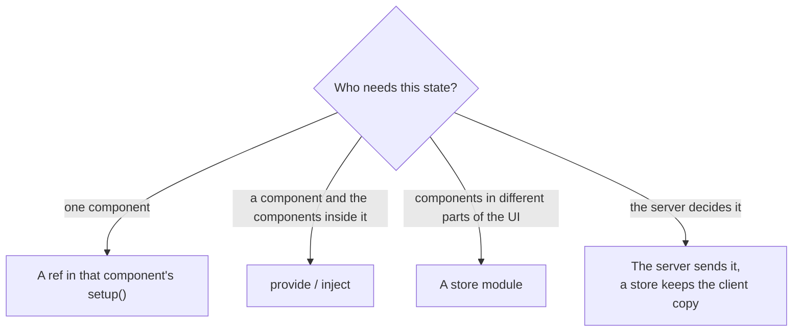
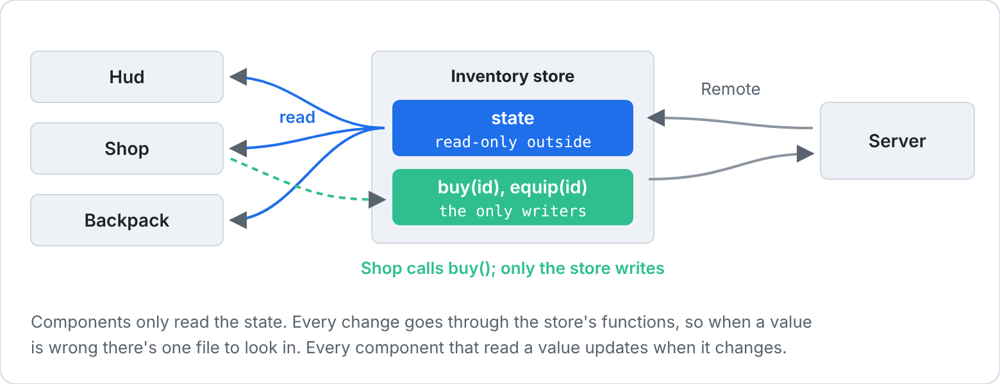

[Docs](../README.md) › [Guide](../GUIDE.md) › **14. Organising state**

# 14. Organising state

Where should a piece of state live? This chapter answers that, then builds a complete store,
syncs data the server owns, and makes purchases feel instant.

## Where state lives



Start local. Move state up only when a second component needs it.

## A store module

[Chapter 8](08-state-and-server.md#game-wide-state-a-store-module) introduced stores. Here's a
fuller one, with derived state that outlives any component. Components only read it, and only the
store's own functions write:



```lua
-- UI/stores/Inventory.luau
local Rivue = require(game.ReplicatedStorage.RivueUI)

local state = Rivue.reactive({
	coins = 100,
	owned = {} :: { string },
})

-- If a component's setup is the first to require this module, a computed made here would belong to
-- that component and stop when it unmounts. A detached scope belongs to no component, so its
-- computeds live as long as the game does.
local scope = Rivue.effectScope(true)

local Inventory = {}

-- Components get a read-only view: writes to it are ignored (and logged when Rivue.debug.enabled is on)
Inventory.state = Rivue.readonly(state)

Inventory.ownedCount = scope:run(function()
	return Rivue.computed(function()
		return #state.owned
	end)
end)

function Inventory.owns(id: string): boolean
	return table.find(Rivue.toRaw(state.owned), id) ~= nil
end

return Inventory
```

```lua
-- UI/components/CoinCounter.luau
local Inventory = require("../stores/Inventory")

render = function()
	return h("TextLabel", {
		Text = `{Inventory.state.coins} coins · {Inventory.ownedCount.value} items`,
	})
end,
```

## Server-owned data

For a few simple values, attributes are the easy route. `attributeRef` gives you a ref that
follows one:

```lua
-- Server
player:SetAttribute("Coins", 250)

-- Client, in the store
local coins = Rivue.attributeRef(Players.LocalPlayer, "Coins", 0)
```

Lists and bigger data go through Remote instead. Load once, then apply the changes the server
pushes:

```lua
-- Client, in the store
local Remote = require(game.ReplicatedStorage.RivueRemote)

task.spawn(function()
	local items = Remote.request("inventory:list", nil)
	if items then
		state.owned = items
	end
end)

Remote.on("inventory:added", function(id: string)
	Rivue.array.push(state.owned, id)
end)
```

```lua
-- Server, wherever an item is given
Remote.send(player, "inventory:added", itemId)
```

On the server, `Remote.handle` can take a `check` function that rejects a malformed payload before
your handler sees it, and `Remote.use` runs a check before every action, such as "has this
player's data loaded yet". See [RivueRemote](../api/remote.md).

## Optimistic updates

Waiting for the server makes a buy button feel slow. Apply the change right away, and roll it
back if the server says no:


```lua
-- In the Inventory store
function Inventory.buy(id: string, price: number): (boolean, string?)
	if state.coins < price then
		return false, "not_enough_coins"
	end

	-- Apply now
	state.coins -= price
	Rivue.array.push(state.owned, id)

	-- Yields until the server answers
	local result, err = Remote.request("shop:buy", { id = id })
	local ok = result ~= nil and (result :: any).ok

	-- Roll back on refusal
	if not ok then
		state.coins += price
		Rivue.array.removeValue(state.owned, id)
	end
	return ok, err or (result and (result :: any).reason)
end
```

```lua
onClick = function()
	task.spawn(function()
		local ok, reason = Inventory.buy(item.id, item.price)
		if not ok then
			showToast(`Couldn't buy: {reason}`)
		end
	end)
end,
```

## Large data

Data you replace as a whole, like a page of results or a leaderboard, belongs in a `shallowRef`,
which doesn't make its contents reactive. Tables that should never be reactive at all (Instances,
class objects, static config) can be marked with `markRaw`. And for thousands of rows, use
[`VirtualList`](../api/builtins.md#virtuallist).

---

**Try it:** [Shop example](../../examples/components/Shop.luau) (loading, errors, buying)
**Reference:** [readonly()](../api/reactivity-core.md#readonly) ·
[effectScope()](../api/reactivity-advanced.md#effectscope) · [attributeRef()](../api/roblox.md#attributeref) ·
[Remote](../api/remote.md) · [shallowRef()](../api/reactivity-advanced.md#shallowref)

[← 13. Component patterns](13-advanced-components.md) · [Guide contents](../GUIDE.md) · [15. Performance in depth →](15-performance-in-depth.md)
