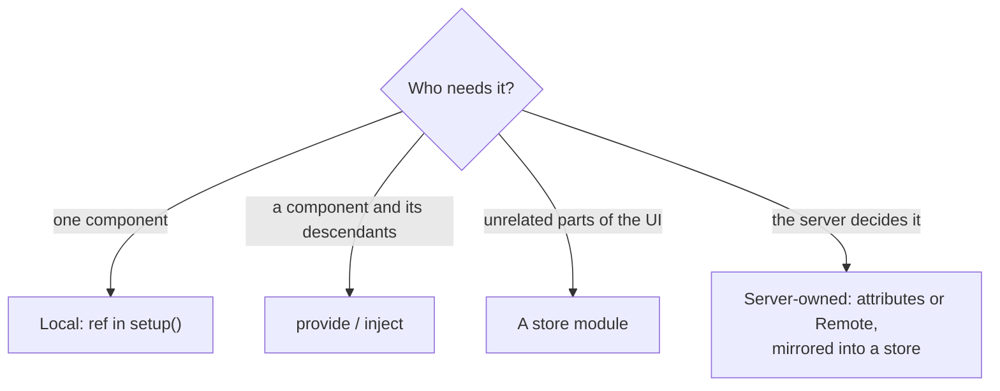

[Docs](../README.md) › [Guide](../GUIDE.md) › **14. State architecture**

# 14. State architecture

**You'll learn:** where state should live as a game grows, how to build a store module, how to keep
client UI in step with the server, and how to make actions feel instant.

## Where should this state live?



Start local. Move state up only when a second component needs it. Most game UI ends up with a few
stores (player data, inventory, settings) and everything else local.

## A store module

A store is a ModuleScript that owns some reactive state. Components read it, and only the store's
own functions change it:

```lua
-- UI/stores/Inventory.luau
local Rivue = require(game.ReplicatedStorage.Rivue)

local state = Rivue.reactive({
	coins = 100,
	owned = {} :: { string },
})

-- Store-level computeds live in a detached scope, so no component's unmount stops them
local scope = Rivue.effectScope(true)

local Inventory = {}
Inventory.state = Rivue.readonly(state) -- components read this, can't write it
Inventory.ownedCount = scope:run(function()
	return Rivue.computed(function()
		return #state.owned
	end)
end)

function Inventory.owns(id: string): boolean
	return table.find(Rivue.toRaw(state.owned), id) ~= nil
end

return Inventory
```

```lua
-- Any component
local Inventory = require("../stores/Inventory") -- from UI/components/

render = function()
	return h("TextLabel", { Text = `{Inventory.state.coins} coins · {Inventory.ownedCount.value} items` })
end,
```

Every component that reads `Inventory.state.coins` updates when it changes, wherever it is.
Because writes only happen in the store's functions, there's one place to look when a value is
wrong.

## Server-owned data

The server is the source of truth for anything that matters (coins, inventory, stats). Two ways
to get it to the UI:

**Attributes**, for a few values per player. The server sets them; the client reads them with
`attributeRef`, which updates by itself:

```lua
-- Server
player:SetAttribute("Coins", 250)

-- Client store
local coins = Rivue.attributeRef(Players.LocalPlayer, "Coins", 0)
```

**Remote events**, for lists and larger data. Load once, then apply the changes the server pushes:

```lua
-- Client store
task.spawn(function()
	local items = Rivue.Remote.request("inventory:list", nil)
	if items then
		state.owned = items
	end
end)

Rivue.Remote.on("inventory:added", function(id: string)
	Rivue.array.push(state.owned, id)
end)
```

## Optimistic updates: instant, with a rollback

Waiting for the server makes buttons feel slow. Update the UI right away, and undo it if the
server says no:

```lua
function Inventory.buy(id: string, price: number): (boolean, string?)
	if state.coins < price then
		return false, "not_enough_coins"
	end

	-- 1. Show the result immediately
	state.coins -= price
	Rivue.array.push(state.owned, id)

	-- 2. Ask the server (yields)
	local result, err = Rivue.Remote.request("shop:buy", { id = id })
	local ok = result ~= nil and (result :: any).ok

	-- 3. Undo if it failed
	if not ok then
		state.coins += price
		Rivue.array.removeValue(state.owned, id)
	end
	return ok, err or (result and (result :: any).reason)
end
```

```lua
-- A buy button calls it off the render path
onClick = function()
	task.spawn(function()
		local ok, reason = Inventory.buy(item.id, item.price)
		if not ok then
			toast(`Couldn't buy: {reason}`)
		end
	end)
end
```

The server still checks everything. The optimistic step only changes what the player sees while
waiting.

## Big data

- **Replace, don't edit?** Use `shallowRef` for data you swap out wholesale (a page of results,
  a leaderboard). Rivue doesn't wrap every nested table, which saves memory and time.
- **Never watched?** `markRaw` tables that should never be reactive: Instances, class objects,
  big static config.
- **Thousands of rows?** Keep the data in a store and render it with
  [`VirtualList`](../api/builtins.md#virtuallist).

---

**Try it:** [Shop example](../../examples/components/Shop.luau) (loading, errors, pending buys)
**Reference:** [readonly()](../api/reactivity-core.md#readonly) ·
[effectScope()](../api/reactivity-advanced.md#effectscope) · [attributeRef()](../api/roblox.md#attributeref) ·
[Remote](../api/remote.md) · [shallowRef()](../api/reactivity-advanced.md#shallowref)

[← 13. Advanced component patterns](13-advanced-components.md) · [Guide contents](../GUIDE.md) · [15. Performance in depth →](15-performance-in-depth.md)
