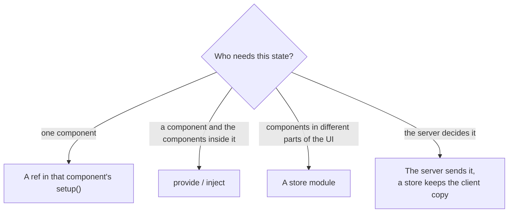
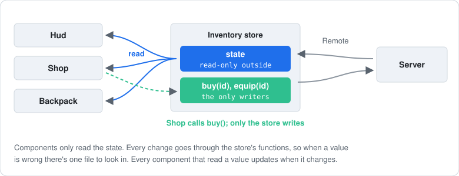
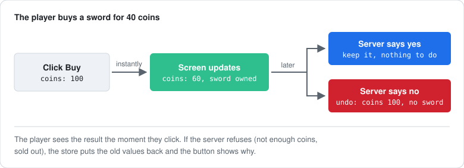

[Docs](../README.md) › [Guide](../GUIDE.md) › **14. Organising state**

# 14. Organising state

**You'll learn:** where state should live, a complete store module, syncing server-owned data,
and optimistic updates.

## Where state lives



Start local and move state up when a second component needs it.

## A store module

[Chapter 8](08-state-and-server.md#game-wide-state-a-store-module) introduced stores. A fuller
one, with derived state that outlives any component. Components read; only the store's functions
write:



```lua
-- UI/stores/Inventory.luau
local Rivue = require(game.ReplicatedStorage.Rivue)

local state = Rivue.reactive({
	coins = 100,
	owned = {} :: { string },
})

-- If a component's setup is the first to require this module, a computed made here would belong to
-- that component and stop when it unmounts. A detached scope belongs to no component, so its
-- computeds live as long as the game does.
local scope = Rivue.effectScope(true)

local Inventory = {}

-- Components get a read-only view: writes to it are ignored (and logged when Rivue.debug.enabled is on)
Inventory.state = Rivue.readonly(state)

Inventory.ownedCount = scope:run(function()
	return Rivue.computed(function()
		return #state.owned
	end)
end)

function Inventory.owns(id: string): boolean
	return table.find(Rivue.toRaw(state.owned), id) ~= nil
end

return Inventory
```

```lua
-- UI/components/CoinCounter.luau
local Inventory = require("../stores/Inventory")

render = function()
	return h("TextLabel", {
		Text = `{Inventory.state.coins} coins · {Inventory.ownedCount.value} items`,
	})
end,
```

## Server-owned data

**Attributes** suit a few simple values. `attributeRef` is a ref that follows the attribute:

```lua
-- Server
player:SetAttribute("Coins", 250)

-- Client, in the store
local coins = Rivue.attributeRef(Players.LocalPlayer, "Coins", 0)
```

**Remote** suits lists and larger data: load once, then apply pushed changes:

```lua
-- Client, in the store
task.spawn(function()
	local items = Rivue.Remote.request("inventory:list", nil)
	if items then
		state.owned = items
	end
end)

Rivue.Remote.on("inventory:added", function(id: string)
	Rivue.array.push(state.owned, id)
end)
```

## Optimistic updates

Apply the change before the server answers, and roll it back if it refuses:



```lua
-- In the Inventory store
function Inventory.buy(id: string, price: number): (boolean, string?)
	if state.coins < price then
		return false, "not_enough_coins"
	end

	-- Apply now
	state.coins -= price
	Rivue.array.push(state.owned, id)

	-- Yields until the server answers
	local result, err = Rivue.Remote.request("shop:buy", { id = id })
	local ok = result ~= nil and (result :: any).ok

	-- Roll back on refusal
	if not ok then
		state.coins += price
		Rivue.array.removeValue(state.owned, id)
	end
	return ok, err or (result and (result :: any).reason)
end
```

```lua
onClick = function()
	task.spawn(function()
		local ok, reason = Inventory.buy(item.id, item.price)
		if not ok then
			showToast(`Couldn't buy: {reason}`)
		end
	end)
end,
```

## Large data

- `shallowRef` for data replaced as a whole (a results page, a leaderboard): its contents aren't
  made reactive.
- `markRaw` for tables that should never be reactive: Instances, class objects, static config.
- [`VirtualList`](../api/builtins.md#virtuallist) for thousands of rows.

---

**Try it:** [Shop example](../../examples/components/Shop.luau) (loading, errors, buying)
**Reference:** [readonly()](../api/reactivity-core.md#readonly) ·
[effectScope()](../api/reactivity-advanced.md#effectscope) · [attributeRef()](../api/roblox.md#attributeref) ·
[Remote](../api/remote.md) · [shallowRef()](../api/reactivity-advanced.md#shallowref)

[← 13. Component patterns](13-advanced-components.md) · [Guide contents](../GUIDE.md) · [15. Performance in depth →](15-performance-in-depth.md)
