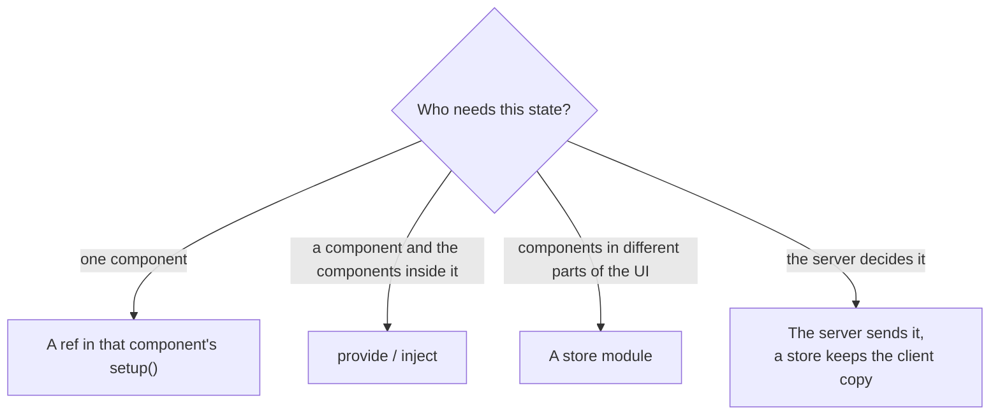

[Docs](../README.md) › [Guide](../GUIDE.md) › **14. Organising state**

# 14. Organising state

**You'll learn:** where each piece of state should live as your game grows, how to write a store
that many components share, how to show data the server owns, and how to make purchases feel
instant.

## Where should this state live?

Ask who needs it:



Some examples:

| State | Who needs it | Where it lives |
|---|---|---|
| Is this dropdown open? | the dropdown | a `ref` in the dropdown |
| Which tab is active? | the tabs and their pages | `provide` in `Tabs` ([chapter 13](13-advanced-components.md)) |
| Coins, owned items | the HUD, the shop, the backpack | an `Inventory` store |
| Music volume | the settings screen, the sound player | a `Settings` store |

Start with a local ref. Move it up only when a second component needs it. Most games end up with
a few stores and everything else local.

## A store module

A store is a ModuleScript that holds some reactive state. Since `require` returns the same table
to every script, every component that requires the store sees the same state.

One rule keeps stores easy to debug: **components read the state, and only the store's own
functions change it.**


```lua
-- UI/stores/Inventory.luau
local Rivue = require(game.ReplicatedStorage.Rivue)

local state = Rivue.reactive({
	coins = 100,
	owned = {} :: { string },
})

-- If a component's setup is the first to require this module, a computed made here would belong to
-- that component and stop when it unmounts. A detached scope belongs to no component, so its
-- computeds live as long as the game does.
local scope = Rivue.effectScope(true)

local Inventory = {}

-- Components get a read-only view: writes to it are ignored (and logged when Rivue.debug.enabled is on)
Inventory.state = Rivue.readonly(state)

Inventory.ownedCount = scope:run(function()
	return Rivue.computed(function()
		return #state.owned
	end)
end)

function Inventory.owns(id: string): boolean
	return table.find(Rivue.toRaw(state.owned), id) ~= nil
end

return Inventory
```

Any component can now show it:

```lua
-- UI/components/CoinCounter.luau
local Inventory = require("../stores/Inventory")

render = function()
	return h("TextLabel", {
		Text = `{Inventory.state.coins} coins · {Inventory.ownedCount.value} items`,
	})
end,
```

When `coins` changes, every component that showed it updates, wherever it is in the UI. And if a
number is ever wrong, you only have to look at the store's functions to find out why.

## Data the server owns

Coins and items are decided by the server, so a cheater can't edit them. The client only shows a
copy. There are two common ways to get that copy.

**Attributes**, for a few simple values. The server sets an attribute on the player, and
`attributeRef` turns it into a ref that updates when the attribute does:

```lua
-- Server
player:SetAttribute("Coins", 250)

-- Client, in the store
local coins = Rivue.attributeRef(Players.LocalPlayer, "Coins", 0)
```

**Remote events**, for lists and bigger data. Ask for everything once when the game starts, then
apply the changes the server sends after that:

```lua
-- Client, in the store
task.spawn(function()
	local items = Rivue.Remote.request("inventory:list", nil)
	if items then
		state.owned = items
	end
end)

Rivue.Remote.on("inventory:added", function(id: string)
	Rivue.array.push(state.owned, id)
end)
```

## Making purchases feel instant

A purchase has to go to the server and back. That can take a few hundred milliseconds, which
makes the Buy button feel slow.

The trick is to update the screen straight away, as if the server had already said yes. In the
rare case it says no, put everything back. This is called an **optimistic update**:


```lua
-- In the Inventory store
function Inventory.buy(id: string, price: number): (boolean, string?)
	if state.coins < price then
		return false, "not_enough_coins"
	end

	-- 1. Update the screen right away
	state.coins -= price
	Rivue.array.push(state.owned, id)

	-- 2. Ask the server. This waits for the answer
	local result, err = Rivue.Remote.request("shop:buy", { id = id })
	local ok = result ~= nil and (result :: any).ok

	-- 3. If the server said no, put things back
	if not ok then
		state.coins += price
		Rivue.array.removeValue(state.owned, id)
	end
	return ok, err or (result and (result :: any).reason)
end
```

`buy` waits for the server, so the Buy button runs it in its own thread with `task.spawn`. The
click handler returns at once and the UI stays responsive:

```lua
onClick = function()
	task.spawn(function()
		local ok, reason = Inventory.buy(item.id, item.price)
		if not ok then
			showToast(`Couldn't buy: {reason}`)
		end
	end)
end,
```

The server must still check everything: the price, the player's coins, whether the item exists.
The optimistic update only changes what the player sees while they wait.

## Large amounts of data

- **Data you replace as a whole** (a page of shop results, a leaderboard): use `shallowRef`.
  `ref` makes every nested table reactive, which costs time and memory you don't need when you
  never edit inside it.
- **Tables that should never be reactive** (Instances, class objects, big config tables): wrap
  them in `markRaw`.
- **Thousands of rows**: keep the data in a store and show it with
  [`VirtualList`](../api/builtins.md#virtuallist), which only creates the rows on screen.

---

**Try it:** [Shop example](../../examples/components/Shop.luau) (loading, errors, buying)
**Reference:** [readonly()](../api/reactivity-core.md#readonly) ·
[effectScope()](../api/reactivity-advanced.md#effectscope) · [attributeRef()](../api/roblox.md#attributeref) ·
[Remote](../api/remote.md) · [shallowRef()](../api/reactivity-advanced.md#shallowref)

[← 13. Component patterns](13-advanced-components.md) · [Guide contents](../GUIDE.md) · [15. Performance in depth →](15-performance-in-depth.md)
