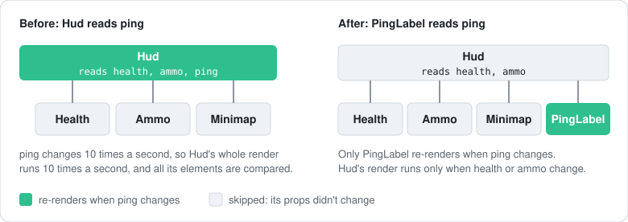
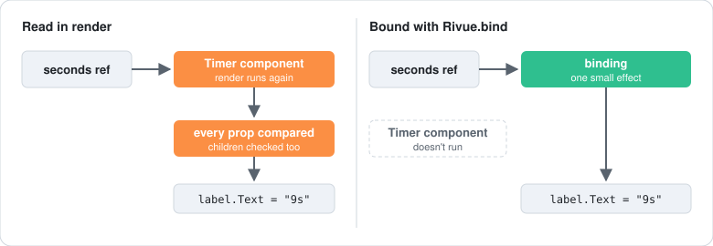

[Docs](../README.md) › [Guide](../GUIDE.md) › **15. Performance in depth**

# 15. Performance in depth

[Chapter 9](09-performance-and-debugging.md#performance) covered the usual fixes. This one goes
further: where render time actually goes, how to see what re-renders, and what to do about it.

## Where the time goes

A state change costs two things: the render functions that read it, and a diff against the
Instances. Rivue only writes properties that changed, so the engine side stays small. What's left
is up to you: how often renders run, and how much each one does.

## Keep fast-changing reads small

Only components whose render read a changed value re-render, and children whose props didn't
change are skipped. So a value that changes ten times a second, like ping, should be read in the
smallest component that shows it:



```lua
-- Network is a store module (chapter 14) whose state.ping the client updates
local PingLabel = Rivue.defineComponent({
	name = "PingLabel",
	render = function()
		return h("TextLabel", { Text = `{Network.state.ping} ms` })
	end,
})

-- In Hud's render, instead of reading ping itself:
h(PingLabel)
```

### Or bind the one property

When the value only feeds one property, you can skip the extra component and bind that property
instead. `Rivue.bind` gives the property its own small effect, so a change writes the label's
`Text` and nothing else re-renders, not even the component that drew it:



```lua
-- In Hud's render
h("TextLabel", {
	Text = Rivue.bind(function()
		return `{Network.state.ping} ms`
	end),
})
```

A ref works too, with no `bind()`: `TextTransparency = fadeRef`. Bindings suit anything that
changes many times a second, like timers, springs and bars. For a value that changes now and
then, reading it in render is simpler and fast enough.

## Finding what re-renders

Besides `onRenderTriggered` and `app:printTree()` from
[chapter 9](09-performance-and-debugging.md#debugging), there are two more tools.
`Rivue.onRenderTracked(fn)` lists every value a render read, which is everything that can make it
re-render. And with `Rivue.debug.enabled` on, `Rivue.debug.measure("label", fn)` logs how long
`fn` took.

## memo and throttle

`memo` skips an element and everything under it while the listed values stay the same:

```lua
Rivue.hFor(ctx.items, function(item)
	return h("Frame", {
		key = item.id,
		memo = { item.id, item.version }, -- only re-check this row when its version changes
	}, {
		h("TextLabel", { Text = item.name }),
		h("ImageLabel", { Image = item.icon }),
	})
end)
```

Careful, though: a value missing from the list won't update the row. List everything it renders
from.

For sources that change every frame, throttle the writes to the ref. The render then follows on
its own:

```lua
setup = function()
	local mouse = Rivue.ref(Vector2.zero)

	local update = Rivue.utils.throttle(function(position: Vector2)
		mouse.value = position
	end, 50)

	Rivue.onRenderStepped(function()
		update(game:GetService("UserInputService"):GetMouseLocation())
	end)

	return { mouse = mouse }
end,
```

## What Rivue already does for you

Some things look expensive but aren't, so don't work around them. A new `onClick` closure on
every render is swapped into the existing connection rather than reconnected. Adding, removing or
moving a row writes one `LayoutOrder`, however long the list. And many writes in a row are
batched, so each affected component renders once, parents first.

---

**Reference:** [onRenderTriggered()](../api/lifecycle.md#onrendertriggered) ·
[VirtualList](../api/builtins.md#virtuallist) · [Pooling options](../api/application.md#pooling-options) ·
[utils.throttle()](../api/utilities.md#utilsthrottle) · [Element props: memo](../api/render-function.md#element-props)

[← 14. Organising state](14-state-architecture.md) · [Guide contents](../GUIDE.md) · [16. Testing UI →](16-testing-ui.md)
