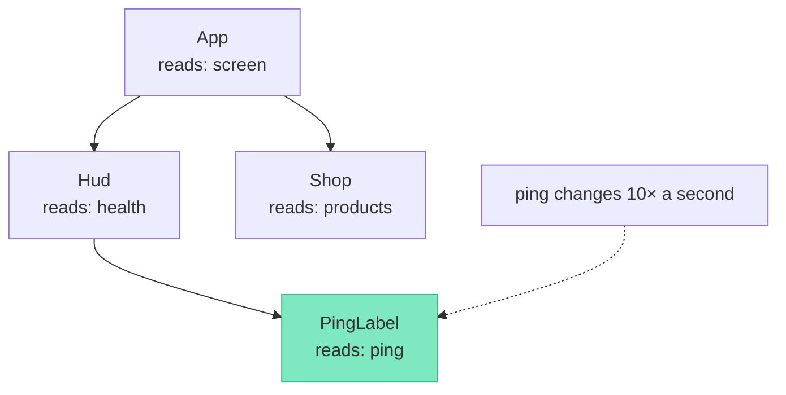

[Docs](../README.md) › [Guide](../GUIDE.md) › **15. Performance in depth**

# 15. Performance in depth

**You'll learn:** what actually costs time in Rivue UI, how to find what's re-rendering and why,
and the fixes that matter, in the order to try them.

## What costs time

Two things:

1. **Engine calls.** Every read or write of an Instance property, and every `IsA` or `Connect`,
   crosses from Luau into the engine. These dominate. Rivue only writes properties that changed,
   and caches what it can, so a re-render that changes one label's text makes one engine call.
2. **Re-running render functions.** Building the description is plain Luau and cheap per call, but
   a big render that runs every frame adds up.

So the goal is: **re-render as little as possible, and only where state changed.**

## Re-renders happen per component

When state changes, Rivue re-renders only the components whose render *read* that state. Not
their parents, and not their siblings.



Only `PingLabel` re-renders. If `Hud` read `ping` itself, the whole HUD would re-render ten times a
second. **The fix for a big component that re-renders too often is usually to move the
fast-changing read into a small child component.**

## Finding out what re-renders

- **Why did it render?** Add a debug hook to the suspect component:

  ```lua
  Rivue.onRenderTriggered(function(event)
  	print("re-rendered because", event.key, "changed")
  end)
  ```

- **What does it depend on?** `Rivue.onRenderTracked` prints every value the render read.
- **What's on screen?** `app:printTree()` prints the live component tree.
- **How long does something take?** `Rivue.debug.measure("label", fn)` logs the time when
  `Rivue.debug.enabled = true`.

## The fixes, in order

| Symptom | Fix |
|---|---|
| A big component re-renders often | move the fast-changing read into a small child component (above) |
| A list re-patches every row on any change | give every item a stable `key` |
| Hundreds or thousands of rows | `Rivue.VirtualList`: only the visible rows exist |
| Rows re-render though their data didn't change | make each row a component, so it only re-renders when *its* item changes |
| A subtree is expensive and rarely changes | `memo = { dep1, dep2 }` skips it while the deps are equal |
| State changes every frame (mouse position, timers) | throttle what you store: update a ref a few times a second, not every frame |
| Big data replaced wholesale | `Rivue.shallowRef` instead of `ref`: no deep proxies |
| Many Instances created and removed (feeds, damage numbers) | `createApp(App, { usePool = true })` reuses them |

`memo` in practice:

```lua
Rivue.hFor(ctx.items, function(item)
	return h("Frame", {
		key = item.id,
		memo = { item.id, item.version }, -- skip this row until its version changes
	}, {
		h("TextLabel", { Text = item.name }),
		h("ImageLabel", { Image = item.icon }),
	})
end)
```

Throttling a value that changes every frame:

```lua
setup = function()
	local mouse = Rivue.ref(Vector2.zero)
	local update = Rivue.utils.throttle(function(position: Vector2)
		mouse.value = position
	end, 50) -- at most 20 updates a second
	Rivue.onRenderStepped(function()
		update(game:GetService("UserInputService"):GetMouseLocation())
	end)
	return { mouse = mouse }
end,
```

## What Rivue already does for you

You don't need to optimise these:

- **Unchanged props aren't written.** A re-render where nothing changed makes no engine calls.
- **New event handlers don't reconnect.** Inline `onClick = function() ... end` closures are
  swapped into the existing connection.
- **List order changes are cheap.** Adding, removing, prepending or moving a row writes one
  `LayoutOrder`, not one per row.
- **Updates are batched.** Changing ten values in a row re-renders each affected component once,
  parents before children.

---

**Reference:** [onRenderTriggered()](../api/lifecycle.md#onrendertriggered) ·
[VirtualList](../api/builtins.md#virtuallist) · [Pooling options](../api/application.md#pooling-options) ·
[utils.throttle()](../api/utilities.md#utilsthrottle) · [Element props: memo](../api/render-function.md#element-props)

[← 14. State architecture](14-state-architecture.md) · [Guide contents](../GUIDE.md) · [16. Testing UI →](16-testing-ui.md)
