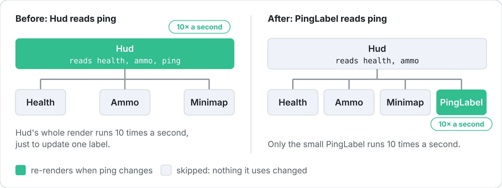
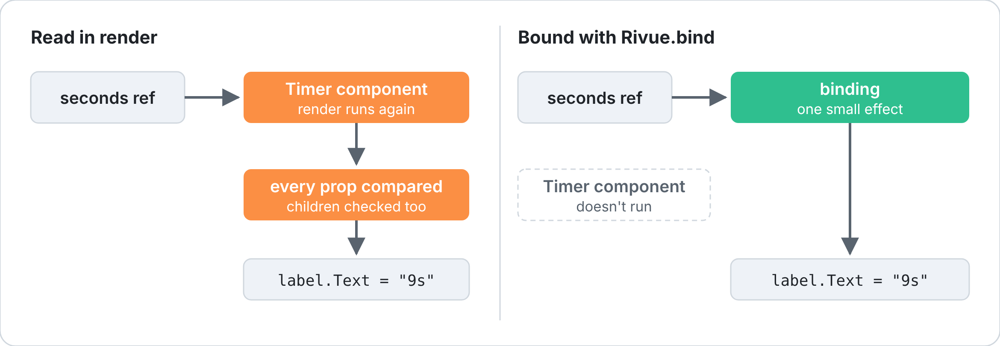

[Docs](../README.md) › [Guide](../GUIDE.md) › **15. Performance in depth**

# 15. Performance in depth

[Chapter 9](09-performance-and-debugging.md#performance) covered the usual fixes. This chapter
covers where render time goes, how to see what re-renders, and what to do about it.

## Where the time goes

A state change costs two things: running the render functions that read it, and diffing their
result against the Instances. Rivue writes only the properties that changed, so the engine side
stays small. What you control is how often renders run and how much each one does.

## Keep fast-changing reads small

Only components whose render read a changed value re-render, and children whose props didn't
change are skipped. A value that changes ten times a second, like ping, should be read in the
smallest component that shows it:



```lua
-- Network is a store module (chapter 14) whose state.ping the client updates
local PingLabel = Rivue.defineComponent({
	name = "PingLabel",
	render = function()
		return h("TextLabel", { Text = `{Network.state.ping} ms` })
	end,
})

-- In Hud's render, instead of reading ping itself:
h(PingLabel)
```

### Or bind the one property

When the value feeds a single property, bind that property instead of adding a component.
`Rivue.bind` gives the property its own small effect, so a change writes the label's `Text` and
nothing re-renders, not even the component that drew it:



```lua
-- In Hud's render
h("TextLabel", {
	Text = Rivue.bind(function()
		return `{Network.state.ping} ms`
	end),
})
```

A ref works too, with no `bind()`: `TextTransparency = fadeRef`. Bindings suit anything that
changes many times a second, like timers, springs and bars. For a value that changes now and
then, reading it in render is simpler and fast enough.

## Finding what re-renders

The [DevTools](../DEVTOOLS.md) Perf tab records renders while you play: which components rendered,
how often, why, and the slowest updates. For frame-level detail, set
`app.config.performance = true` before mounting. Each component's setup, render and patch then
shows up in the MicroProfiler (Ctrl+F6) as `Rivue <Name> render` and so on.

In code, `onRenderTriggered` and `app:printTree()` from
[chapter 9](09-performance-and-debugging.md#debugging) still work. `Rivue.onRenderTracked(fn)`
lists every value a render read, which is everything that can make it re-render.

## memo and throttle

`memo` skips an element and everything under it while the listed values stay the same:

```lua
Rivue.hFor(ctx.items, function(item)
	return h("Frame", {
		key = item.id,
		memo = { item.id, item.version }, -- only re-check this row when its version changes
	}, {
		h("TextLabel", { Text = item.name }),
		h("ImageLabel", { Image = item.icon }),
	})
end)
```

A value missing from the list won't update the row, so list everything it renders from.

For sources that change every frame, throttle the writes to the ref, and the render follows:

```lua
setup = function()
	local mouse = Rivue.ref(Vector2.zero)

	local update = Rivue.utils.throttle(function(position: Vector2)
		mouse.value = position
	end, 50)

	Rivue.onRenderStepped(function()
		update(game:GetService("UserInputService"):GetMouseLocation())
	end)

	return { mouse = mouse }
end,
```

## Long lists and many Instances

`Rivue.VirtualList` creates only the rows on screen, so 5,000 items cost about as much as 20. It
takes the items, a fixed `itemSize`, a `key` function and a `render` function per item, and
`columns` turns it into a grid:

```lua
h(Rivue.VirtualList, {
	Size = UDim2.fromOffset(400, 500),
	items = ctx.items,
	itemSize = 90,
	columns = 4,
	gap = 8,
	key = function(item)
		return item.id
	end,
	render = function(item)
		return h("TextButton", { Text = item.name }) -- Size is set for you
	end,
})
```

For a feed that loads more as the player scrolls, `Rivue.useScroll(frameRef, { onReachEnd = fn })`
calls `fn` near the bottom.

UI that creates and removes Instances all the time, like damage numbers, can reuse them instead:
`createApp(App, { usePool = true })` resets removed Instances and hands them out again. See
[Pooling options](../api/application.md#pooling-options).

## What Rivue already does for you

Some things look expensive but aren't, so there's no need to work around them. A new `onClick` closure on
every render is swapped into the existing connection rather than reconnected. Adding, removing or
moving a row writes one `LayoutOrder`, however long the list. And many writes in a row are
batched, so each affected component renders once, parents first.

---

**Reference:** [onRenderTriggered()](../api/lifecycle.md#onrendertriggered) ·
[VirtualList](../api/builtins.md#virtuallist) · [Pooling options](../api/application.md#pooling-options) ·
[utils.throttle()](../api/utilities.md#utilsthrottle) · [useScroll()](../api/roblox.md#usescroll) ·
[app.config.performance](../api/application.md#appconfigperformance) · [Element props: memo](../api/render-function.md#element-props)

[← 14. Organising state](14-state-architecture.md) · [Guide contents](../GUIDE.md) · [16. Testing UI →](16-testing-ui.md)
