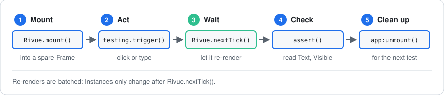

[Docs](../README.md) › [Guide](../GUIDE.md) › **16. Testing UI**

# 16. Testing UI

**You'll learn:** how to check that your UI logic works without play-testing every time: testing
composables on their own, mounting a component in a test, and clicking its buttons from code.

The examples use plain `assert`, so they work in any test runner: TestEZ, Jest Lua, or a Script
you run in Studio.

## What to test, and how

| What you're testing | How | |
|---|---|---|
| Logic: limits, sorting, what gets saved | Call the composable or store directly | fastest |
| A component shows the right thing and reacts to clicks | Mount it into a Frame and click from code | fast |
| Dragging, clicking outside, gamepad, screen size | Play-test it | by hand |

The more logic you keep in composables and stores ([chapter 12](12-writing-composables.md)),
the more of it falls into the first row, where tests are short and quick.

## Testing a composable

Here's a composable for a "how many?" picker in a shop. It keeps the amount between a minimum and
a maximum, and says whether the + and - buttons can be used:

```lua
local function useStepper(options: { min: number, max: number, start: number? })
	local value = Rivue.ref(options.start or options.min)
	local canDecrease = Rivue.computed(function()
		return value.value > options.min
	end)
	local canIncrease = Rivue.computed(function()
		return value.value < options.max
	end)
	return {
		value = value,
		canDecrease = canDecrease,
		canIncrease = canIncrease,
		increase = function()
			if canIncrease.value then
				value.value += 1
			end
		end,
		decrease = function()
			if canDecrease.value then
				value.value -= 1
			end
		end,
	}
end
```

Outside a component, call it inside an `effectScope`. The scope collects the computeds and
watchers it creates, so `scope:stop()` cleans them all up at the end of the test:

```lua
local scope = Rivue.effectScope()
local stepper = scope:run(function()
	return useStepper({ min = 1, max = 3 })
end)

stepper.increase()
stepper.increase()
stepper.increase() -- already at 3, so nothing happens
assert(stepper.value.value == 3)
assert(stepper.canIncrease.value == false)
assert(stepper.canDecrease.value == true)

scope:stop()
```

Refs and computeds update the moment you change them, so the asserts can run straight away.

### Watchers run a moment later

Watchers are different. When you change a value, Rivue waits until your code has finished making
changes, then runs each watcher once. In a test, `Rivue.nextTick()` waits for that.

This composable saves the player's settings whenever they change:

```lua
local function useAutosave(settings, save: (any) -> ())
	Rivue.watch(settings, function(value)
		save(value)
	end, { deep = true })
end
```

The test changes the volume twice and expects only **one** save, with the final value:

```lua
local saves = {}
local settings = Rivue.reactive({ music = true, volume = 50 })

local scope = Rivue.effectScope()
scope:run(function()
	useAutosave(settings, function(value)
		table.insert(saves, value.volume)
	end)
end)

settings.volume = 60
settings.volume = 70
assert(#saves == 0) -- the watcher hasn't run yet
Rivue.nextTick()
assert(#saves == 1 and saves[1] == 70) -- it ran once, with the latest value

scope:stop()
settings.volume = 80
Rivue.nextTick()
assert(#saves == 1) -- stopping the scope stopped the watcher
```

The last three lines catch a common bug: a composable that keeps running after its component is
gone.

## Testing a component

A component test always has the same five steps:



To mount a component, give it a Frame that isn't in the game. Rivue still creates real
Instances in it, so you can read their `Text` and `Visible` just as the player would see them.

This helper mounts a component and returns a `find` function that looks elements up by `Name`:

```lua
local h = Rivue.h

local function mountForTest(component, props: { [string]: any }?)
	local root = Instance.new("Frame")
	local app = Rivue.mount(h(component, props), root)
	local function find(name: string): any
		for _, child in root:GetDescendants() do
			if child.Name == name then
				return child
			end
		end
		error(`no element named {name}`, 2)
	end
	return app, find
end
```

So give the elements you want to test a `Name`. It also makes them easier to spot in the
Explorer.

Here's the picker as a component. It uses `useStepper` and emits `change` with the new amount:

```lua
local QuantityPicker = Rivue.defineComponent({
	name = "QuantityPicker",
	props = {
		max = { type = "number", default = 10 },
	},
	emits = { "change" },
	setup = function(props, ctx)
		local stepper = useStepper({ min = 1, max = props.max })
		local function change(step: () -> ())
			step()
			ctx.emit("change", stepper.value.value)
		end
		return {
			value = stepper.value,
			canIncrease = stepper.canIncrease,
			canDecrease = stepper.canDecrease,
			increase = function()
				change(stepper.increase)
			end,
			decrease = function()
				change(stepper.decrease)
			end,
		}
	end,
	render = function(ctx)
		return h("Frame", { layout = "horizontal", Size = UDim2.fromOffset(160, 40) }, {
			h("TextButton", { Name = "Minus", Text = "-", Active = ctx.canDecrease, onClick = ctx.decrease }),
			h("TextLabel", { Name = "Amount", Text = tostring(ctx.value) }),
			h("TextButton", { Name = "Plus", Text = "+", Active = ctx.canIncrease, onClick = ctx.increase }),
		})
	end,
})
```

### Clicking a button

A script can't fire a button's `Activated` event; Roblox doesn't allow it. Instead,
`Rivue.testing.trigger(element, "onClick")` calls the button's `onClick` handler, which is what
a real click would do:

```lua
local changes = {}
local app, find = mountForTest(QuantityPicker, {
	max = 2,
	onChange = function(amount) -- listens to the change event, like a parent would
		table.insert(changes, amount)
	end,
})

assert(find("Amount").Text == "1")

Rivue.testing.trigger(find("Plus"), "onClick")
Rivue.testing.trigger(find("Plus"), "onClick") -- already at the max of 2
Rivue.nextTick() -- wait for the re-render

assert(find("Amount").Text == "2")
assert(find("Plus").Active == false)
assert(changes[1] == 2 and changes[2] == 2) -- one change event per click

app:unmount()
```

Without `Rivue.nextTick()`, `Amount` would still say `1`. Re-renders wait for your code to finish
changing state, just like watchers.

If the element has no handler for that event, `trigger` throws an error. So a test that clicks
the wrong element fails, instead of passing without testing anything.

### Typing into a text box

Setting a TextBox's `Text` from a script counts as typing, so `model` picks it up. Then trigger
`onFocusLost` with `true`, which is what Roblox passes when the player pressed Enter:

```lua
local NameInput = Rivue.defineComponent({
	name = "NameInput",
	emits = { "submit" },
	setup = function(_props, ctx)
		local draft = Rivue.ref("")
		return {
			draft = draft,
			submit = function(enterPressed: boolean)
				if enterPressed and draft.value ~= "" then
					ctx.emit("submit", draft.value)
					draft.value = ""
				end
			end,
		}
	end,
	render = function(ctx)
		return h("TextBox", { Name = "Input", model = "draft", onFocusLost = ctx.submit })
	end,
})

local submitted
local app, find = mountForTest(NameInput, {
	onSubmit = function(text)
		submitted = text
	end,
})

local box = find("Input")
box.Text = "Sword"
Rivue.testing.trigger(box, "onFocusLost", true)
Rivue.nextTick()

assert(submitted == "Sword")
assert(box.Text == "") -- the box clears after submitting

app:unmount()
```

## What a script can't test

Some things only the engine can do. A script can't fire `UserInputService` events like
`InputBegan`, and it can't change the camera's `ViewportSize`. So `vClickOutside`, `vDrag`,
`useInputType()` and `useViewportSize()` need play-testing.

You can still test the decisions behind them. Put the decision in a plain function, and leave
only the wiring to the engine:

```lua
-- Easy to test: give it a width, check the answer
local function columnsFor(width: number): number
	return if width < 600 then 1 elseif width < 1000 then 2 else 3
end

assert(columnsFor(400) == 1)
assert(columnsFor(1280) == 3)

-- The wiring: check this by play-testing on a phone and on a PC
local Grid = Rivue.defineComponent(function()
	local viewport = Rivue.useViewportSize()
	local columns = Rivue.computed(function()
		return columnsFor(viewport.value.X)
	end)
	return function()
		return h("Frame", { layout = { grid = UDim2.new(1 / columns.value, -8, 0, 120), gap = 8 } })
	end
end, { name = "Grid" })
```

## Tips

- **Check what the player would see:** text, visibility, events sent to the parent. Avoid checking
  a component's internal refs, so you can change its code without rewriting the tests.
- **Test one thing per test.** When "Plus stops at the max" fails, you know where to look. When
  "the picker works" fails, you don't.
- **When you fix a bug, write a test that fails without the fix.** Then the bug can't quietly
  come back.
- **Wait with `Rivue.nextTick()`, not `task.wait()`.** `task.wait()` happens to wait long
  enough, but `nextTick()` makes it clear what you're waiting for.

---

**Reference:** [testing.trigger()](../api/utilities.md#testingtrigger) ·
[nextTick()](../api/scheduler.md#nexttick) · [effectScope()](../api/reactivity-advanced.md#effectscope) ·
[mount()](../api/application.md#mount)

[← 15. Performance in depth](15-performance-in-depth.md) · [Guide contents](../GUIDE.md)
