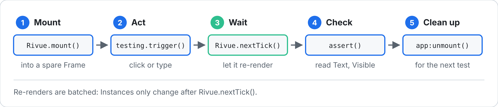

[Docs](../README.md) › [Guide](../GUIDE.md) › **16. Testing UI**

# 16. Testing UI

Most UI logic can be tested from code, button clicks included. This chapter covers composables,
then components, then the few things that need a playtest. The examples use plain `assert`, so
they work with any test runner.

## Testing a composable

Take a quantity picker for the shop, written as a composable:

```lua
local function useStepper(options: { min: number, max: number, start: number? })
	local value = Rivue.ref(options.start or options.min)
	local canDecrease = Rivue.computed(function()
		return value.value > options.min
	end)
	local canIncrease = Rivue.computed(function()
		return value.value < options.max
	end)
	return {
		value = value,
		canDecrease = canDecrease,
		canIncrease = canIncrease,
		increase = function()
			if canIncrease.value then
				value.value += 1
			end
		end,
		decrease = function()
			if canDecrease.value then
				value.value -= 1
			end
		end,
	}
end
```

A test has no component to own the composable's state, so run it inside an `effectScope`.
`scope:stop()` then cleans up its computeds and watchers:

```lua
local scope = Rivue.effectScope()
local stepper = scope:run(function()
	return useStepper({ min = 1, max = 3 })
end)

stepper.increase()
stepper.increase()
stepper.increase() -- already at 3, so nothing happens
assert(stepper.value.value == 3)
assert(stepper.canIncrease.value == false)
assert(stepper.canDecrease.value == true)

scope:stop()
```

Refs and computeds update straight away, so there's nothing to wait for.

### Watchers need nextTick()

Watchers are batched: they run once after a burst of changes, so a test waits with
`Rivue.nextTick()`. Take an autosave composable:

```lua
local function useAutosave(settings, save: (any) -> ())
	Rivue.watch(settings, function(value)
		save(value)
	end, { deep = true })
end
```

Two changes, and only one save:

```lua
local saves = {}
local settings = Rivue.reactive({ music = true, volume = 50 })

local scope = Rivue.effectScope()
scope:run(function()
	useAutosave(settings, function(value)
		table.insert(saves, value.volume)
	end)
end)

settings.volume = 60
settings.volume = 70
assert(#saves == 0) -- the watcher hasn't run yet
Rivue.nextTick()
assert(#saves == 1 and saves[1] == 70) -- it ran once, with the latest value

scope:stop()
settings.volume = 80
Rivue.nextTick()
assert(#saves == 1) -- stopping the scope stopped the watcher
```

## Testing a component

`Rivue.testing.render` mounts a component into a Frame that isn't parented anywhere. Rivue still
creates real Instances, so a test reads their `Text` and `Visible` directly, and finds them by the
text the player sees, the way Testing Library does on the web.

Here's the picker as a component that emits `change`:

```lua
local QuantityPicker = Rivue.defineComponent({
	name = "QuantityPicker",
	props = {
		max = { type = "number", default = 10 },
	},
	emits = { "change" },
	setup = function(props, ctx)
		local stepper = useStepper({ min = 1, max = props.max })
		local function change(step: () -> ())
			step()
			ctx.emit("change", stepper.value.value)
		end
		return {
			value = stepper.value,
			canIncrease = stepper.canIncrease,
			canDecrease = stepper.canDecrease,
			increase = function()
				change(stepper.increase)
			end,
			decrease = function()
				change(stepper.decrease)
			end,
		}
	end,
	render = function(ctx)
		return h("Frame", { layout = "horizontal", Size = UDim2.fromOffset(160, 40) }, {
			h("TextButton", { Name = "Minus", Text = "-", Active = ctx.canDecrease, onClick = ctx.decrease }),
			h("TextLabel", { Name = "Amount", Text = tostring(ctx.value) }),
			h("TextButton", { Name = "Plus", Text = "+", Active = ctx.canIncrease, onClick = ctx.increase }),
		})
	end,
})
```

### Clicking a button

Scripts can't fire `Activated`, so `Rivue.testing.click` runs the button's click handler instead,
then waits for the re-render:

```lua
local changes = {}
local screen = Rivue.testing.render(QuantityPicker, {
	max = 2,
	onChange = function(amount)
		table.insert(changes, amount)
	end,
})

assert(screen.getByText("1"))

Rivue.testing.click(screen.getByText("+"))
Rivue.testing.click(screen.getByText("+")) -- already at the max of 2

assert(screen.getByText("2"))
assert(screen.getByName("Plus").Active == false)
assert(changes[1] == 2 and changes[2] == 2) -- one change event per click

screen.unmount()
```

`getByText` fails the test when the text isn't there, or is there twice. `queryByText` returns nil
instead, for checking that something is gone. `click` errors when the element has no click
handler, so clicking the wrong thing fails instead of passing quietly.

### Typing into a text box

`Rivue.testing.typeInto` sets the box's `Text` and then runs `onFocusLost` as if the player pressed
Enter:

```lua
local NameInput = Rivue.defineComponent({
	name = "NameInput",
	emits = { "submit" },
	setup = function(_props, ctx)
		local draft = Rivue.ref("")
		return {
			draft = draft,
			submit = function(enterPressed: boolean)
				if enterPressed and draft.value ~= "" then
					ctx.emit("submit", draft.value)
					draft.value = ""
				end
			end,
		}
	end,
	render = function(ctx)
		return h("TextBox", { Name = "Input", model = "draft", onFocusLost = ctx.submit })
	end,
})

local submitted
local screen = Rivue.testing.render(NameInput, {
	onSubmit = function(text)
		submitted = text
	end,
})

local box = screen.getByName("Input")
Rivue.testing.typeInto(box, "Sword")

assert(submitted == "Sword")
assert(box.Text == "") -- the box clears after submitting

screen.unmount()
```

For any other event, `Rivue.testing.trigger(element, "onMouseEnter")` calls that handler directly.
It doesn't wait, so follow it with `Rivue.nextTick()` before checking the result. A test built
from `Rivue.mount`, `trigger` and `nextTick` goes through these steps, which `testing.render` and
`click` otherwise do for you:



## What a script can't test

A script can't drive `UserInputService` events or the camera's `ViewportSize`, so
`vClickOutside`, `vDrag`, `useInputType()` and `useViewportSize()` need a playtest. Keep the
decision in a plain function and test that, so only the wiring goes untested:

```lua
local function columnsFor(width: number): number
	return if width < 600 then 1 elseif width < 1000 then 2 else 3
end

assert(columnsFor(400) == 1)
assert(columnsFor(1280) == 3)

-- playtest this part
local Grid = Rivue.defineComponent(function()
	local viewport = Rivue.useViewportSize()
	local columns = Rivue.computed(function()
		return columnsFor(viewport.value.X)
	end)
	return function()
		return h("Frame", { layout = { grid = UDim2.new(1 / columns.value, -8, 0, 120), gap = 8 } })
	end
end, { name = "Grid" })
```

## Previewing in a storybook

To preview a component without pressing Play, make a story with `Rivue.story` and open it in UI
Labs or Hoarcekat:

```lua
-- ShopItem.story.luau
return Rivue.story(ShopItem, {
	controls = { name = "Iron Sword", price = 40 }, -- editable in UI Labs
})
```

---

**Reference:** [testing.render()](../api/utilities.md#testingrender) ·
[testing.click()](../api/utilities.md#testingclick-and-testingtypeinto) · [testing.trigger()](../api/utilities.md#testingtrigger) ·
[nextTick()](../api/scheduler.md#nexttick) · [effectScope()](../api/reactivity-advanced.md#effectscope) ·
[mount()](../api/application.md#mount) · [story()](../api/utilities.md#story)

[← 15. Performance in depth](15-performance-in-depth.md) · [Guide contents](../GUIDE.md) · [17. Screens and navigation →](17-screens-and-navigation.md)
