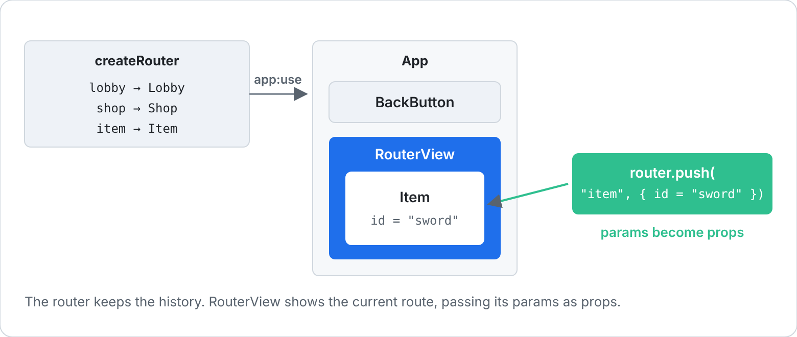
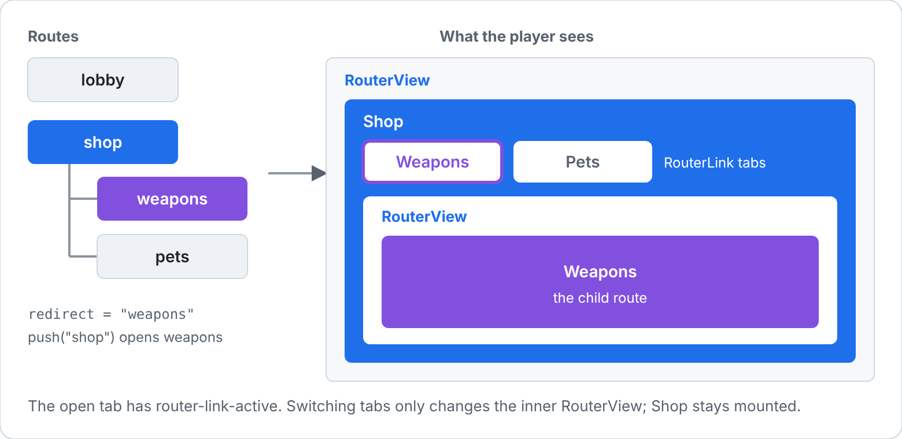
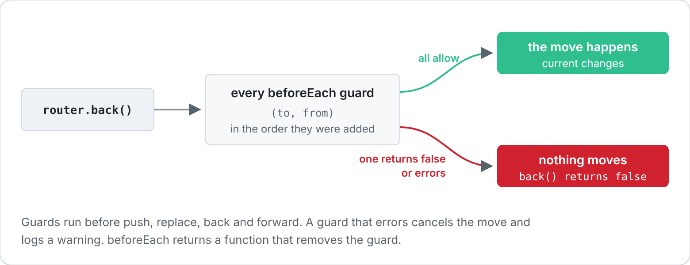

[Docs](../README.md) › [Guide](../GUIDE.md) › **17. Screens and navigation**

# 17. Screens and navigation

A lobby, a shop, an item page, settings: once a game has more than two or three screens, you
want a back button that works, screens that pass each other data, and a way to stop the player
leaving a form half filled in. That's what RivueRouter is for.

[Chapter 13](13-advanced-components.md#switching-screens) switched screens with a lookup table,
which is still the right call for tabs. Reach for the router once screens open other screens.

## Setting it up

RivueRouter is its own package, like Vue Router. Install it next to RivueUI (see the
[README](../../README.md#installation)) and it finds RivueUI by itself.



Give each screen a name, pick the first one, and put a `RouterView` where screens should appear:

```lua
local Rivue = require(game.ReplicatedStorage.RivueUI)
local Router = require(game.ReplicatedStorage.RivueRouter)
local h = Rivue.h

local router = Router.createRouter({
	routes = {
		lobby = Lobby,
		shop = Shop,
		item = Item,
		settings = Settings,
	},
	initial = "lobby",
})

local App = Rivue.defineComponent({
	name = "App",
	render = function()
		return h("ScreenGui", { ResetOnSpawn = false }, {
			h(Router.RouterView),
		})
	end,
})

local app = Rivue.createApp(App)
app:use(router)
app:mountToPlayerGui(game.Players.LocalPlayer)
```

`app:use(router)` has to come before mounting. Any component inside the app can then get the
router with `Router.useRouter()`.

## Moving between screens

Four functions move you around. The history works like a browser's:


```lua
local router = Router.useRouter()

router.push("shop") -- open a screen, add it to the history
router.back() -- the screen before
router.forward() -- undo a back
router.replace("lobby") -- swap the current screen, without adding to the history
router.go(-2) -- two screens back
```

A few things to know:

- Pushing after going back drops the screens you could have gone forward to (step 4 in the
  picture).
- `replace` suits screens you never want to come back to, like a loading or login screen. After
  `replace`, `back` skips it.
- Pushing the screen that's already open, with the same params, does nothing. A double-tapped
  button doesn't leave two copies in the history for the player to back through.
- They all return `nil` when they moved. When they didn't, they return a
  [navigation failure](../api/router.md#navigation-failures) that says why.

## Passing data to a screen

The second argument to `push` becomes the screen's props:

```lua
local Item = Rivue.defineComponent({
	name = "Item",
	props = {
		id = { type = "string", required = true },
	},
	setup = function(props)
		local item = Rivue.computed(function()
			return Catalog[props.id]
		end)
		return { item = item }
	end,
	render = function(ctx)
		return h("TextLabel", { Text = ctx.item.name })
	end,
})

-- In the shop
router.push("item", { id = "sword" })
```

Pass ids, and let the screen look the rest up in a store. If you pass the whole item table
instead, going back to that screen later shows the item as it was when you pushed it, even if
the store has changed since.

A component deeper inside the screen can read the params with `Router.useRoute()` instead of
having them passed down: `route.params.id`.

For something that isn't part of what the screen is, like which tab is open, use a query, as in
Vue Router. It doesn't change which screen matches, and links stay active whatever the query is:

```lua
router.push({ name = "item", params = { id = "sword" }, query = { tab = "stats" } })
-- in the screen: Router.useRoute().query.tab
```

## A back button

`canGoBack` is a ref, so a back button can hide itself on the first screen. Bind Escape and the
gamepad's B button to it too, but only while there's somewhere to go back to:

```lua
local BackButton = Rivue.defineComponent({
	name = "BackButton",
	setup = function()
		local router = Router.useRouter()
		Rivue.useKeybind({ Enum.KeyCode.Escape, Enum.KeyCode.ButtonB }, function()
			-- A guard may wait for the player, so don't hold up the input callback
			task.spawn(router.back)
		end, { enabled = router.canGoBack })
		return { canGoBack = router.canGoBack, back = router.back }
	end,
	render = function(ctx)
		return h("TextButton", { Text = "Back", Visible = ctx.canGoBack, onActivated = ctx.back })
	end,
})
```

Put it in `App`, next to the `RouterView`, rather than in each screen. Then there's one binding
for the whole game.

If you only need the keys, without a button, let the router bind them:

```lua
local router = Router.createRouter({
	routes = routes,
	initial = "lobby",
	backKeys = { Enum.KeyCode.Escape, Enum.KeyCode.ButtonB },
})
```

The keys go back while there's history, and reach the rest of the game when there isn't.

## Screens inside screens

A shop with tabs for weapons and pets is one screen with smaller screens inside it. Make the tabs
child routes, and give the shop its own `RouterView` for them:



```lua
local Shop = Rivue.defineComponent({
	name = "Shop",
	render = function()
		return h(Rivue.Column, { gap = 8 }, {
			h(Rivue.Row, { gap = 8 }, {
				h(Router.RouterLink, { to = "weapons", class = "tab", Text = "Weapons" }),
				h(Router.RouterLink, { to = "pets", class = "tab", Text = "Pets" }),
			}),
			h(Router.RouterView),
		})
	end,
})

local router = Router.createRouter({
	routes = {
		lobby = Lobby,
		shop = {
			component = Shop,
			redirect = "weapons", -- opening the shop opens its first tab
			children = {
				weapons = Weapons,
				pets = Pets,
			},
		},
	},
	initial = "lobby",
})
```

`RouterLink` is a TextButton that opens its route when pressed. While its route is open it gets
the `router-link-active` style class, so the open tab can look different:

```lua
app:styles({
	tab = { TextColor3 = Color3.fromRGB(150, 150, 160) },
	["router-link-active"] = { TextColor3 = Color3.new(1, 1, 1) },
})
```

A link to `shop` stays active on either tab, since they're inside the shop. Use
`router-link-exact-active` for a style that only applies to the exact route.

Switching tabs keeps the `Shop` component mounted. Only the inner `RouterView` changes.

## Stopping the player from leaving

Before every move, `back` and `forward` included, the router runs its guards. Any of them can
cancel the move or send the player somewhere else:



The usual case is a settings screen with changes that aren't saved yet. Put an
`onBeforeRouteLeave` guard in the screen. It can wait for the player to answer, and the move
waits with it:

```lua
local Settings = Rivue.defineComponent({
	name = "Settings",
	setup = function()
		local dirty = Rivue.ref(false)
		local asking = Rivue.ref(false)
		local answer = Instance.new("BindableEvent")
		Rivue.onUnmounted(function()
			answer:Destroy()
		end)

		Router.onBeforeRouteLeave(function()
			if not dirty.value then
				return true
			end
			asking.value = true
			local leave = answer.Event:Wait()
			asking.value = false
			return leave
		end)

		return {
			asking = asking,
			change = function()
				dirty.value = true
			end,
			stay = function()
				answer:Fire(false)
			end,
			leave = function()
				answer:Fire(true)
			end,
		}
	end,
	render = function(ctx)
		return h("Frame", { Size = UDim2.fromScale(1, 1) }, {
			h("TextButton", { Text = "Music: on", onActivated = ctx.change }),
			h(Rivue.Dialog, { open = ctx.asking, onClose = ctx.stay }, {
				h(Rivue.Column, { gap = 12 }, {
					h("TextLabel", { Text = "Leave without saving?", Size = UDim2.fromOffset(240, 30) }),
					h(Rivue.Row, { gap = 8 }, {
						h("TextButton", { Text = "Stay", Size = UDim2.fromOffset(100, 36), onActivated = ctx.stay }),
						h("TextButton", { Text = "Leave", Size = UDim2.fromOffset(100, 36), onActivated = ctx.leave }),
					}),
				}),
			}),
		})
	end,
})
```

It doesn't matter how the player tried to leave: Back, a tab, or a button that pushes another
screen. The guard returns the player's answer, and the move goes ahead or doesn't.

Guards that concern the whole game go on the router. `beforeEach` runs for every move, and can
return a route to go to instead:

```lua
router.beforeEach(function(to)
	if to.name == "shop" and not PlayerData.loaded then
		return "loading"
	end
	return true
end)
```

A guard that errors cancels the move and logs a warning, so a bug in a guard can't send the
player somewhere half set up.

## After every move

`afterEach` runs once a move is done. Together with `meta` on a route, it handles things that
depend on which screen is open, like music or the HUD:

```lua
local router = Router.createRouter({
	routes = {
		lobby = { component = Lobby, meta = { music = "calm" } },
		shop = { component = Shop, meta = { music = "shop", hideHud = true } },
	},
	initial = "lobby",
})

router.afterEach(function(to, _from, failure)
	if failure then
		return
	end
	Music.play(to.meta.music)
	Hud.setVisible(not to.meta.hideHud)
end)
```

A child route's `meta` includes its parents', so the shop's tabs hide the HUD too.

## Animating between screens

Give the `RouterView` a slot and it hands you the screen instead of showing it, so you can wrap
it in a `Transition`:

```lua
h(Router.RouterView, nil, {
	default = function(view)
		return h(Rivue.Transition, Rivue.transitions.fade({ mode = "out-in" }), { view.Component })
	end,
})
```

`mode = "out-in"` fades the old screen out before the new one fades in. The slot also gets
`view.route`, so the animation can depend on the screen.

## Keeping screens alive

Normally a screen is unmounted when you leave it, and mounted fresh when you come back. For a
shop with a search box and a long scrolling list, that loses the player's place. Turn on
`keepAlive`:

```lua
h(Router.RouterView, { keepAlive = true })
```

Screens you leave now stay in a [KeepAlive](../api/builtins.md#keepalive): the shop is still
scrolled where it was and the search still says "sword". Use `onActivated` and `onDeactivated`
(see [lifecycle hooks](../api/lifecycle.md)) for work that should pause while a screen is hidden.

Keeping every screen alive costs memory. If all you want back is the scroll position, use
`scrollBehavior` instead:

```lua
local router = Router.createRouter({
	routes = routes,
	initial = "lobby",
	scrollBehavior = function(_to, _from, savedPosition)
		return savedPosition or { top = 0 }
	end,
})
```

On `back` and `forward`, `savedPosition` holds where each ScrollingFrame in the screen was when
the player left it. Returning it scrolls them back there. Any other move starts at the top.

## Testing navigation

The router doesn't need a player or a ScreenGui. Mount the app into a Folder, move around, and
check `currentRoute`:

```lua
local router = Router.createRouter({ routes = { lobby = Lobby, item = Item }, initial = "lobby" })
local app = Rivue.createApp(App)
app:use(router)
app:mount(Instance.new("Folder"))

assert(router.push("item", { id = "sword" }) == nil)
assert(router.currentRoute.value.name == "item")
assert(router.canGoBack.value)

router.back()
assert(router.currentRoute.value.name == "lobby")
app:unmount()
```

---

**Try it:** [GameMenu example](../../examples/components/GameMenu.luau) (back button, tabs, leave guard
with a Dialog) · [tests/Router.test.luau](../../tests/Router.test.luau) covers every feature here
**Reference:** [RivueRouter](../api/router.md) · [KeepAlive](../api/builtins.md#keepalive) ·
[Dialog](../api/builtins.md#dialog) · [useKeybind()](../api/roblox.md#usekeybind) ·
[Transition](../api/builtins.md#transition)

[← 16. Testing UI](16-testing-ui.md) · [Guide contents](../GUIDE.md)
